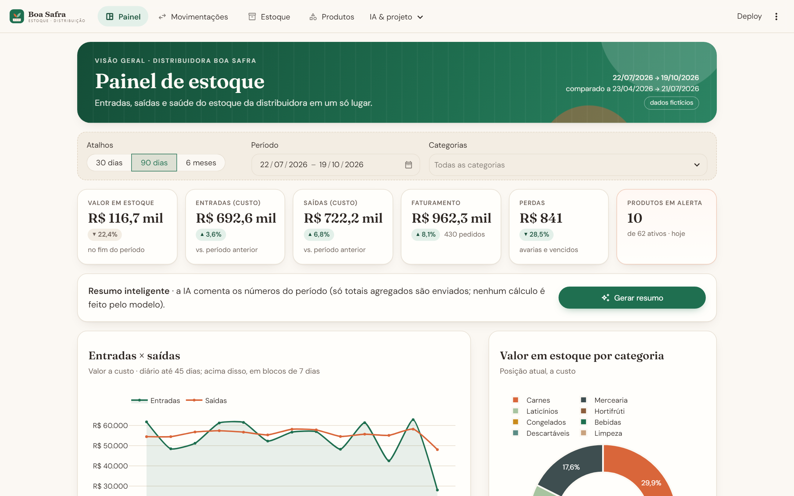
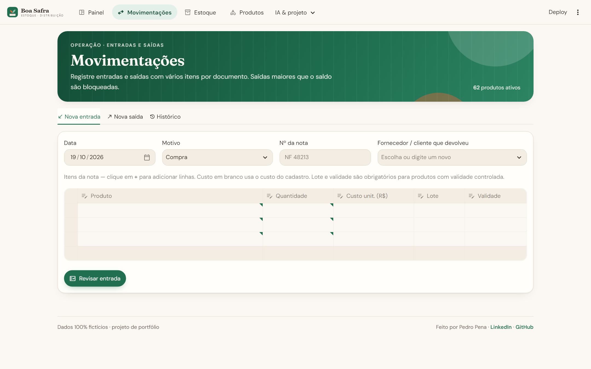

# Boa Safra · Controle de Entrada e Saída de Mercadorias

App em **Streamlit** para uma distribuidora de alimentos (food service) controlar entradas,
saídas e estoque: cadastro de produtos, lançamentos com vários itens por documento, saldo
calculado a partir do histórico, alertas de mínimo e de validade (FEFO), curva ABC,
reposição sugerida, painel com indicadores e **IA (Gemini)** para importar notas fiscais
a partir do texto colado.

> **Todos os dados são fictícios.** A "Distribuidora Boa Safra", fornecedores, clientes e
> notas foram inventados e são gerados por `gerar_dados.py`.

**Demonstração ao vivo:** _(link do Streamlit Community Cloud será adicionado aqui)_

| Painel | Movimentações |
|---|---|
|  |  |

## Funcionalidades

- **Painel** — 6 KPIs com variação contra o período anterior de mesmo tamanho (valor em
  estoque, entradas, saídas, faturamento, perdas, produtos em alerta), entradas × saídas no
  tempo, valor em estoque por categoria, top 10 produtos por saída, curva ABC (Pareto) e
  lista do que precisa de atenção hoje.
- **Filtros globais** de período (atalhos 30/90 dias/6 meses ou intervalo livre) e categorias,
  guardados no Session State: valem no Painel, no Estoque e no Histórico.
- **Movimentações**
  - *Entrada* (compra ou devolução de cliente): nº da nota, fornecedor e uma grade editável de
    itens com lote e validade, dentro de um `st.form`.
  - *Saída* (venda, perda ou transferência): grade de itens com **conferência de saldo ao vivo**;
    a saída maior que o saldo é **bloqueada no servidor** (validação em `servicos/estoque.py`
    e de novo dentro da transação em `db.py`).
  - Confirmação em `st.dialog` antes de gravar e aviso com `st.toast`.
  - *Histórico* com busca, filtro por tipo, seleção de linha para ver os itens e exportação
    **CSV/Excel** do que está filtrado.
- **Estoque** — saldo por produto, status com cor + texto (**OK / Abaixo do mínimo / Zerado /
  Vencendo em 30 dias**), barra de saldo × mínimo, valor em estoque, **reposição sugerida**
  (até 2× o mínimo, ajustável) agrupada por fornecedor, **curva ABC** (por saídas do período ou
  valor em estoque) e **lotes por validade** calculados com **FEFO**.
- **Produtos** — catálogo com busca, cadastro e edição com validação (SKU único no formato
  `AAA-0000`, preço ≥ custo, mínimo inteiro para un/cx…) e desativação sem perder histórico.
- **Importar nota com IA** — cole o texto de uma NF-e/DANFE ou de um pedido por e-mail
  (há 2 exemplos prontos), o Gemini devolve **JSON estruturado**, o app sugere o SKU de cada
  item por similaridade e você confere tudo numa grade antes de lançar a entrada.
- **Resumo inteligente** no Painel — 3 a 5 observações geradas a partir dos números agregados.

## Como a IA é usada (e por que ela não calcula estoque)

1. **Extração com saída estruturada.** `servicos/ia.py` chama o Gemini com
   `response_mime_type="application/json"` e `response_schema=NotaExtraida` (modelo Pydantic com
   fornecedor, número, data e itens: descrição, quantidade, unidade, custo, lote, validade). A
   resposta já chega validada como objeto Python; se vier fora do esquema, o app avisa em vez de
   gravar lixo.
2. **Casamento com o catálogo sem IA.** A descrição lida ("QJ MUSSARELA FATIADA KG") é comparada
   aos produtos cadastrados com `difflib` + sobreposição de palavras e normalização de
   abreviações. Abaixo de 45% de similaridade o app **não sugere** nada — melhor pedir a escolha ao
   usuário do que lançar no produto errado.
3. **Humano no circuito.** Tudo aparece num `st.data_editor` para conferir, trocar o SKU,
   desmarcar itens e ajustar valores; a gravação passa pela mesma validação da entrada manual e
   por um diálogo de confirmação.
4. **Resumo com agregados.** O "Resumo inteligente" envia ao modelo **apenas totais já calculados**
   (KPIs, contagem por status, top 5 etc.), nunca as movimentações. A resposta também usa esquema
   (`Resumo`) e fica em cache pelo conteúdo, para não gastar cota repetindo a mesma pergunta.

**O modelo nunca calcula saldo, valor ou reposição.** LLMs erram contas e podem "inventar"
números; aqui eles só transformam texto em dados (extração) e dados em texto (resumo). Toda conta
é feita em pandas/SQL, de forma determinística.

Sem `GEMINI_API_KEY` o app mostra como configurar e **continua funcionando**; na página de
importação há um *modo demonstração* que usa o resultado pré-pronto dos exemplos.

## Conceitos de Streamlit aplicados → onde no código

| Conceito | Como aparece | Onde |
|---|---|---|
| Multipage com navegação no topo | `st.navigation(..., position="top")`, `st.Page`, seções | `app.py` |
| Componentes reutilizáveis | cabeçalho, cartão de KPI, badge de status, estado vazio, insights | `componentes/ui.py` |
| CSS integrado + tema | cores e fontes Google (DM Sans + Fraunces) no tema; cartões, badges e navegação no CSS | `.streamlit/config.toml`, `estilo/estilo.css` |
| Session State | filtros globais com chaves espelho e callbacks; fila de toasts; reset de formulários | `componentes/filtros.py`, `componentes/feedback.py` |
| `persist_state` | texto da nota e modelo de IA sobrevivem à troca de página | `paginas/importar_ia.py` |
| Formulários | `st.form` com validação (produto e entrada) | `paginas/produtos.py`, `paginas/movimentacoes.py` |
| Grade editável | `st.data_editor` com `SelectboxColumn`, `DateColumn`, linhas dinâmicas | `paginas/movimentacoes.py`, `paginas/importar_ia.py` |
| Diálogos | `st.dialog` para confirmar gravação e desativação | `componentes/dialogos.py`, `paginas/produtos.py` |
| Feedback | `st.toast`, `st.status` (etapas da IA), `st.spinner` | `componentes/feedback.py`, `paginas/importar_ia.py` |
| `column_config` | `ProgressColumn` (saldo × mínimo, similaridade), `NumberColumn`, `DateColumn`, `CheckboxColumn`, colunas fixas | `paginas/estoque.py` |
| Tabelas com estilo | pandas Styler: R$ 1.234,56 e cores de status, mantendo a ordenação numérica | `componentes/tabelas.py` |
| Seleção em tabela | `st.dataframe(on_select="rerun")` abre os itens da movimentação | `paginas/movimentacoes.py` |
| Cache | `@st.cache_resource` (conexão SQLite, cliente Gemini) e `@st.cache_data` com `ttl` + limpeza após escrita | `db.py`, `servicos/` |
| Performance | CSV/Excel gerados só no clique (`download_button` recebe função); FEFO e posição calculados uma vez e cacheados | `componentes/tabelas.py`, `servicos/estoque.py` |
| Visualização | Plotly com tema próprio, separador decimal brasileiro e Pareto com eixo duplo | `componentes/graficos.py` |
| IA / LLM | Gemini com `response_schema` (Pydantic) e prompt com regras explícitas | `servicos/ia.py` |

## Stack

Python 3.12 · Streamlit 1.66 · pandas · Plotly · SQLite (`sqlite3`) · Google Gen AI SDK
(`google-genai`) · Pydantic · openpyxl

## Como rodar

```bash
python -m venv .venv
.venv\Scripts\activate          # Windows  (Linux/macOS: source .venv/bin/activate)
pip install -r requirements.txt
streamlit run app.py
```

Na primeira execução o banco `dados/estoque.db` é **criado e populado automaticamente**
(~60 produtos e ~6 meses de movimentações relativas à data de hoje). Para recriar do zero:
`python gerar_dados.py`.

### Chave do Gemini (opcional)

1. Gere uma chave gratuita em [Google AI Studio](https://aistudio.google.com) → *Get API key*.
2. Copie `.streamlit/secrets.toml.example` para `.streamlit/secrets.toml` e cole a chave:
   ```toml
   GEMINI_API_KEY = "sua-chave"
   ```
   (ou defina a variável de ambiente `GEMINI_API_KEY`). No Streamlit Community Cloud, use
   *Settings → Secrets*. O `secrets.toml` está no `.gitignore`.

## Estrutura

```
estoque-mercadorias-streamlit/
├── app.py                  # configuração, CSS, navegação no topo
├── db.py                   # todo o SQL: esquema, consultas em cache, gravações em transação
├── gerar_dados.py          # simulação de 6 meses de operação (dados fictícios)
├── formatos.py             # R$ 1.234,56 · 12,5 kg · 19/10/2026
├── servicos/
│   ├── estoque.py          # regras de negócio: saldo, FEFO, status, ABC, reposição, validação
│   └── ia.py               # Gemini: extração estruturada, resumo, casamento de SKU
├── componentes/
│   ├── ui.py               # cabeçalho, KPI, badges, estado vazio
│   ├── filtros.py          # filtros globais no Session State
│   ├── graficos.py         # gráficos Plotly no tema do app
│   ├── tabelas.py          # Styler pt-BR, colunas e exportação CSV/Excel
│   ├── dialogos.py         # confirmação de movimentação
│   └── feedback.py         # toasts que sobrevivem ao st.rerun()
├── paginas/                # painel, movimentações, estoque, produtos, importar_ia, sobre
├── estilo/                 # estilo.css e logo.svg
├── .streamlit/             # config.toml (tema) e secrets.toml.example
├── dados/                  # estoque.db (gerado, fora do Git)
└── docs/                   # capturas de tela
```

---

Feito por **Pedro Pena** · [LinkedIn](https://www.linkedin.com/in/pedropena23/) ·
[GitHub](https://github.com/PPena23)
